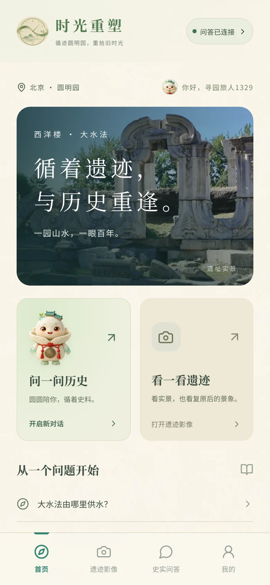
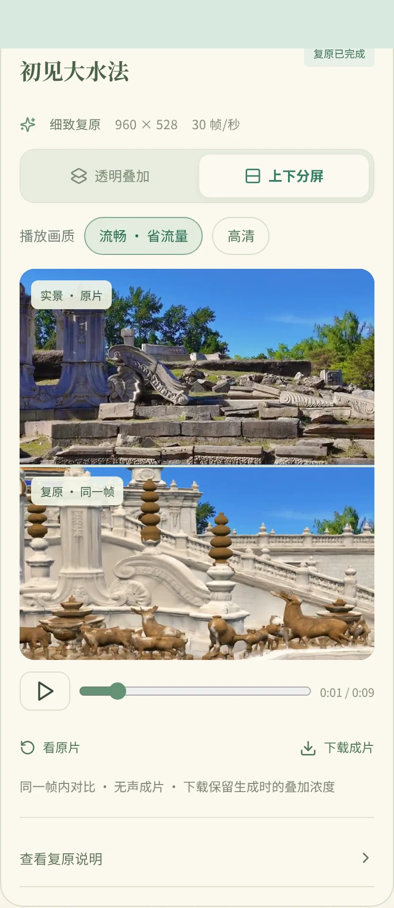

# 时光重塑使用手册

<div class="guide-hero">
  <div class="hero-words"><p class="overline">TIME RESHAPE · 圆圆陪你看园林</p><h2>循迹圆明园，<br>重拾旧时光。</h2><p>从一段史料、一帧影像开始。<br>让圆圆陪你读懂历史，也看见遗迹的另一种模样。</p><div class="hero-actions"><a class="guide-button" href="quick-start.html">开始第一次体验 <span>↗</span></a><a class="guide-button outline" href="downloads.html">安装与下载</a></div></div>
  <div class="hero-scene"><span class="scene-caption">北京 · 圆明园大水法</span></div>
</div>

<div class="edition-line"><span class="status-dot"></span> Android 与网页 · v{{ version }} <span>使用指南 · 安装 · 常见问题</span></div>

## 你想从哪里开始？

<div class="guide-cards">
<a class="guide-card" href="guide/questions.html"><span class="card-number">01 / 问历史</span><h3>和圆圆聊一聊</h3><p>提出圆明园相关问题，阅读故事、史实依据与资料来源。</p><span class="card-more">打开问答指南 ↗</span></a>
<a class="guide-card" href="guide/restoration.html"><span class="card-number">02 / 看今昔</span><h3>观看遗迹复原</h3><p>从预计算示例开始，用透明叠加或上下分屏对照实景。</p><span class="card-more">打开影像指南 ↗</span></a>
<a class="guide-card" href="guide/live-camera.html"><span class="card-number">03 / 到现场</span><h3>开启实时相机</h3><p>选择手机协同或云端计算，把镜头对准大水法遗址。</p><span class="card-more">选择相机方案 ↗</span></a>
</div>

## 熟悉的页面，一步步走近

<div class="app-gallery">
<figure><figcaption>首页 · 从好奇心出发</figcaption></figure>
<figure><figcaption>问答 · 循着史料寻找答案</figcaption></figure>
<figure><figcaption>影像 · 对照同一刻的今昔</figcaption></figure>
</div>

## 认识时光重塑

时光重塑是一款围绕圆明园的史实问答与遗迹数字复原应用。你可以直接提问，或选择大水法影像观看模型复原。圆圆是陪你阅读与探索的形象；当前版本不提供替你执行任意任务的智能体。

安卓安装包把完整页面、圆圆图片和界面动画保存在手机中。问答、资料同步和复原仍连接服务器。网页预览与安卓应用保留相同的主要功能和视觉风格。

:::{note}
数字复原用于辅助理解现有模型，不是遗址原貌的考古定论。当前影像定位支持大水法地图覆盖范围；问答中史料不足的内容会明确说明。
:::

第一次使用，建议先看[三分钟入门](quick-start.md)。已有账号换设备，请看[账号与历史](guide/account.md)；遇到连接或画面问题，请直接看[常见问题](faq.md)。

```{toctree}
:hidden:
:caption: 开始体验
quick-start
downloads
guide/connection
```

```{toctree}
:hidden:
:caption: 使用指南
guide/questions
guide/restoration
guide/live-camera
guide/account
guide/privacy
```

```{toctree}
:hidden:
:caption: 帮助与更新
faq
releases
about
```
